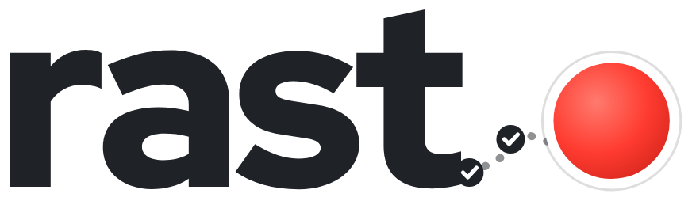
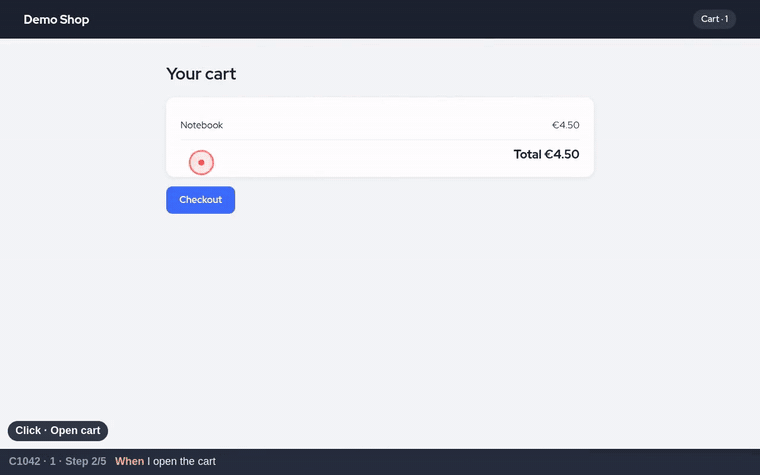
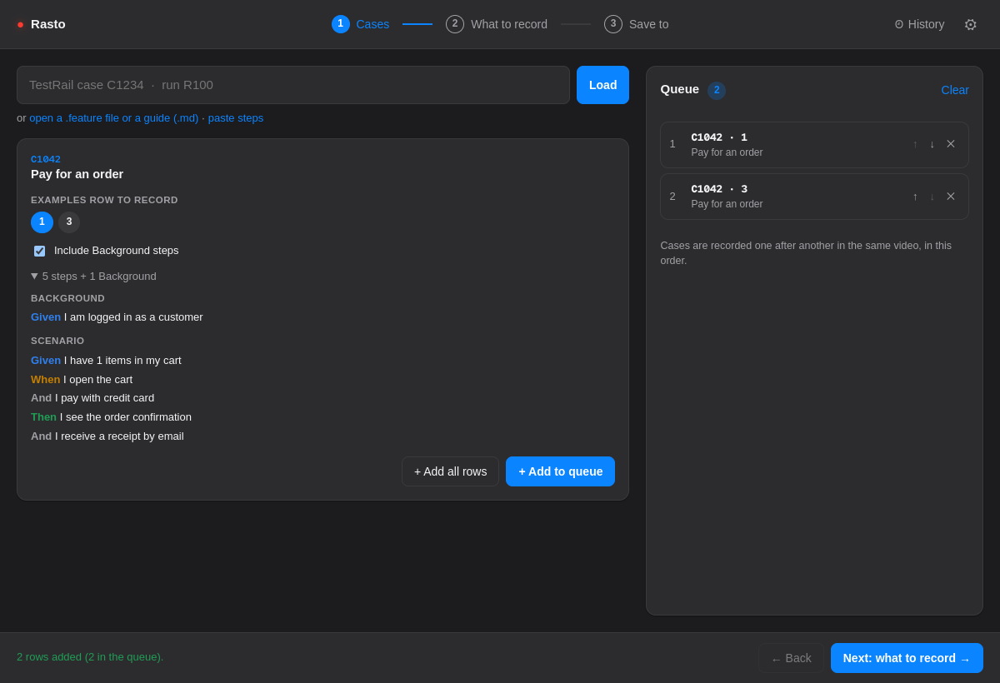
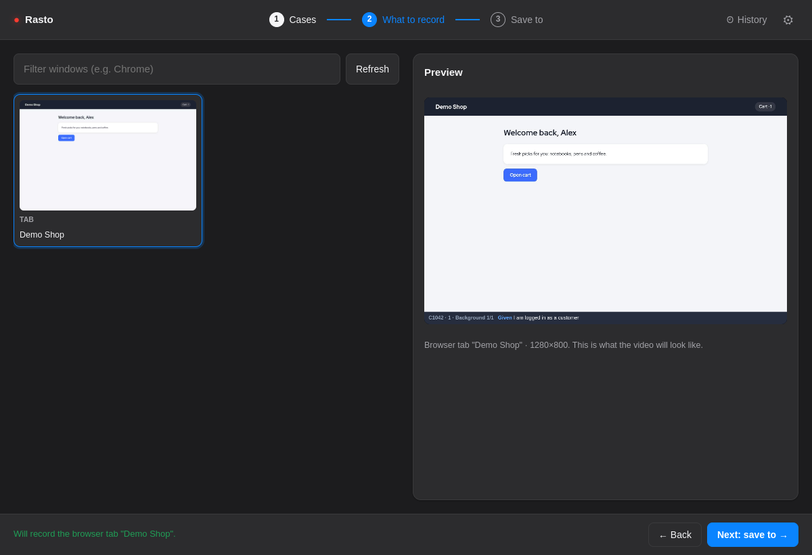
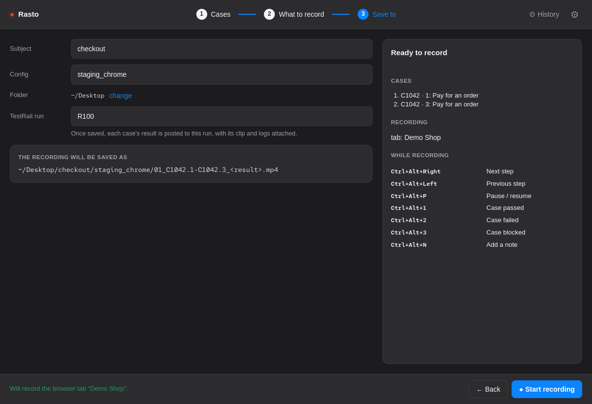
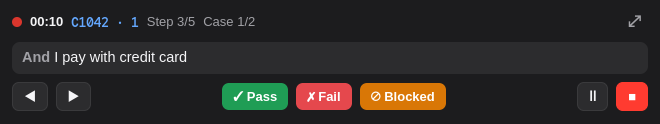
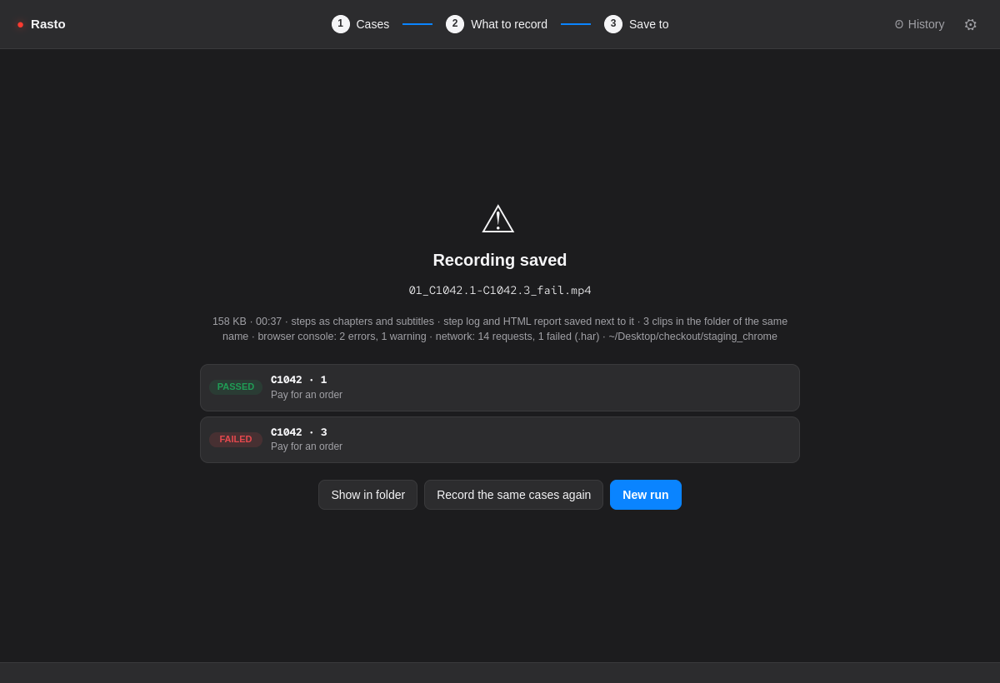
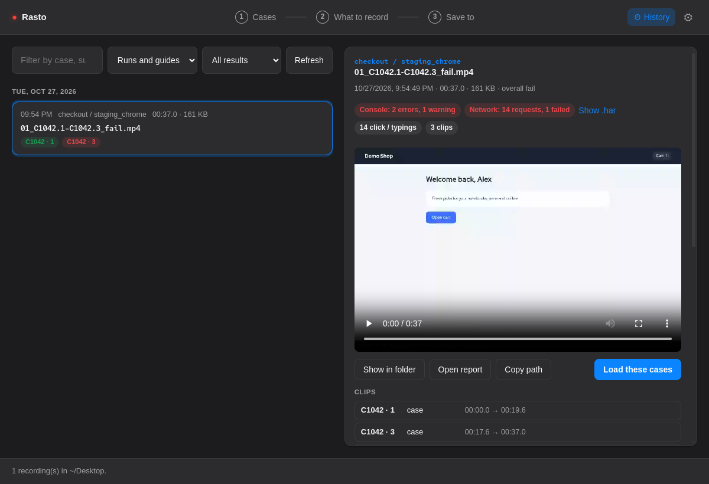
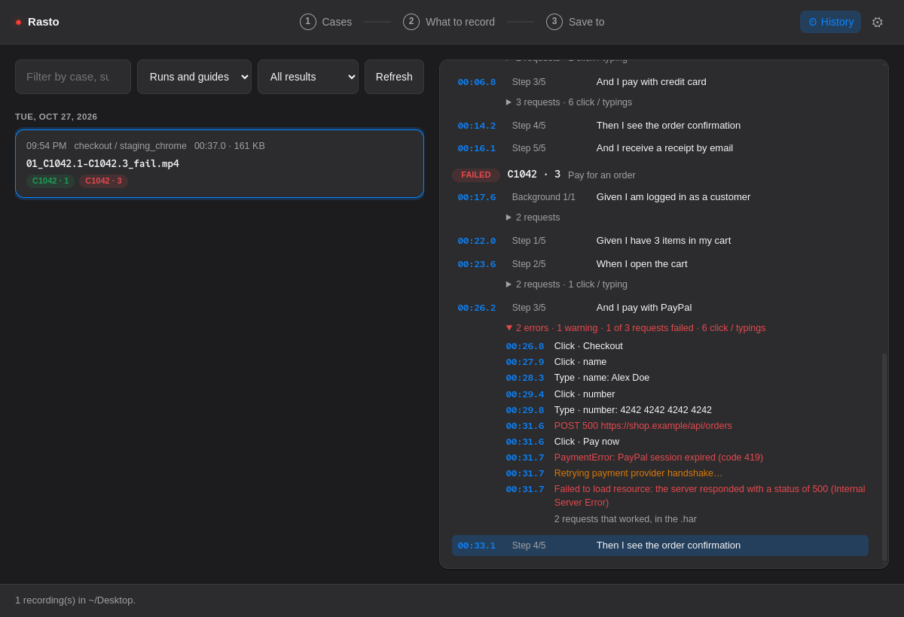
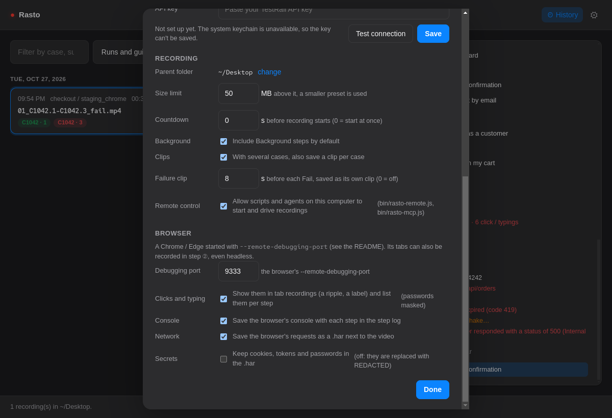

<h1>
  <picture>
    <source media="(prefers-color-scheme: dark)" srcset="docs/wordmark-dark.png">
    
  </picture>
</h1>

**Every manual test leaves a trail: a short, step-labelled video and a log that prove what you tested, where, and what
happened, with no video editing.**

*Rasto* is Portuguese for "trail". A local desktop app (Electron + TypeScript) for macOS, Windows and Linux.



## What it does

- **Records your manual test** (a window, a screen or a browser tab) with the current Gherkin step burned into the
  video, and saves a small, case-named MP4.
- **Pass / Fail / Blocked with one hotkey.** Queue several cases and record them in one go; each result flashes in the
  video and the next case starts.
- **Cases from anywhere:** a TestRail case or run, a `.feature` file, or pasted steps.
- **A step log** next to the video, with each step's time, so a reviewer can jump straight to it. The steps are also
  chapters and subtitles of the MP4.
- **Clips:** one per case, and the last seconds before every Fail.
- **A shareable report:** one `.html` per recording with the video inside, every step and what happened during it.
  Send it to anyone; it opens offline in any browser.
- **Console and network:** with Chrome or Edge started with a debugging port, the page's console errors go under each
  step and its network into a `.har`, secrets redacted.
- **Posts the results to TestRail**, with the steps, clips and logs attached.
- **History** of every recording, played inside Rasto with its evidence per step.
- **Remote control** (HTTP API, CLI, MCP server) so scripts and AI agents can drive it, even with a headless browser,
  and a **pytest-bdd plugin** that records automated scenarios with the steps in sync.

## Words used here

Test cases are written in [Gherkin](https://cucumber.io/docs/gherkin/reference/), the Given / When / Then format of
`.feature` files:

- **Scenario:** one test case, as Given / When / Then steps.
- **Scenario Outline** and **Examples row:** a scenario with placeholders (`<method>`) and an Examples table; each row
  is one run of it. Rasto records one row at a time and shows it in the banner (`C101 · Guest`).
- **Background:** steps every scenario of the feature starts with (e.g. logging in). You can leave them out of the
  video when that setup happens off camera.
- **Guide:** not a test but a how-to video, from a Markdown file with numbered steps (see *Guides*).
- **Subject** and **Config:** the two folder levels recordings are filed under, e.g. what you tested and where
  (`checkout/staging_chrome`).

## Install

Download the build for your OS from [Releases](https://github.com/Nozeren/rasto/releases), or build it yourself with
the command under each OS. The builds are not signed, so each OS warns once on first launch.

**macOS**

```bash
npm run dist        # → release/Rasto-0.1.0-arm64.dmg
```

1. Open the `.dmg` and drag **Rasto** into **Applications**.
2. First launch: macOS blocks it once. Right-click Rasto → **Open** → **Open** (or System Settings → Privacy &
   Security → **Open Anyway**).
3. Allow **Screen Recording** for Rasto when asked (step ② in the app links to the setting), then quit and reopen it.

**Windows**

```bash
npm run dist:win    # → an NSIS installer (.exe) in release/
```

Run the installer. If SmartScreen warns, **More info** → **Run anyway**.

**Linux**

```bash
npm run dist:linux  # → an .AppImage in release/
chmod +x release/*.AppImage && ./release/*.AppImage
```

**Then, on any OS:** **⚙ Settings → TestRail**: enter the URL, user and API key, **Test connection**. The key is stored
encrypted with the system keychain (on Linux this needs a secret service such as GNOME Keyring or KWallet). When Rasto
is started from a terminal, the `TESTRAIL_*` variables also work (see *Development*).

To run from source instead, see *Development*.

## How to use

```
open -a Rasto            # installed app (macOS)
cd path/to/rasto && npm start   # or from source
```

The app walks you through three steps (top bar), then records:

1. **① Cases.** Type a TestRail case (`C1234`) or run (`R100`) and press Enter, or *open a .feature file* /
   *paste steps*. For a run, filter and click a test. On the case card pick the **Examples row** (or **+ Add all rows**),
   untick **Include Background steps** if the setup happens off camera, and **+ Add to queue**. The queue on the right
   is the recording order (↑ ↓ ✕). With an empty queue, the loaded case is recorded on its own.

   
2. **② What to record.** Click the browser window's card (filter by name). The **Preview** shows exactly what the
   video will look like, banner included.

   
3. **③ Save to.** Set **Subject** and **Config** (recent values are suggested); the full file name is shown. Click
   **● Start recording**.

   
4. **Recording.** After a short countdown, the main window hides and a small **HUD** stays on top, kept out of the
   video. Switch to the browser and step through with the hotkeys or the HUD buttons (more in *Steps, hotkeys and the
   HUD*):

   

   | Do | macOS | Windows / Linux |
   |---|---|---|
   | Next / previous step | ⌃⌥→ / ⌃⌥← | Ctrl+Alt+Right / Left |
   | Pause / resume (paused time isn't recorded) | ⌃⌥P | Ctrl+Alt+P |
   | Close the case: Pass / Fail / Blocked | ⌃⌥1 / ⌃⌥2 / ⌃⌥3 | Ctrl+Alt+1 / 2 / 3 |

   Each result flashes in the video for 2 s and the next case starts; after the last one the recording stops itself.
5. **Done.** The file name, size and per-case results are shown. **Show in folder** opens the `.mp4` and its `.json`
   step log (plus the clips folder, see *What a recording leaves*). With a **TestRail run** set in ③, each case's
   result is then posted to it (see *Posting results to TestRail*); the Done screen lists how each case went, with
   **Try again** if some failed. **Record the same cases again** (e.g. in another config) or **New run**.

   Next to the video, Rasto also writes the **report**: one `.html` file to send to someone without Rasto (see *What a
   recording leaves*).

   

6. **🕘 History** (top right) lists every recording under the parent folder, newest first and grouped by day, with
   the result of each case. Filter by case, subject, config, file or result. Pick one to **play it inside Rasto**;
   click any step to jump the video to that moment. **Open report** opens its `.html` report (and writes one for
   recordings made before reports existed). **Load these cases** reloads the run's cases from TestRail (same
   Examples row) into the queue to record them again, e.g. in another config.

   Above the video, the recording's evidence: console errors and warnings, requests and how many failed (**Show .har**
   opens it), clicks and typing, clips. **Clips** play in the same player (**Back to the whole recording** returns).
   Under each step, a folded line sums up what happened while it was on screen (`2 errors · 1 of 7 requests failed ·
   3 click / typings`); unfold it for each console error and warning, failed request and action, with its time: click
   the time to jump the video there.

   

   

**Tips**

- **⚙ Settings** (top right): TestRail access, hotkeys, the parent folder, the size limit, the countdown, the
  Background default, remote control and the browser options (console, network, debugging port).

  
- Keep the address bar in the recorded window: it is usually the evidence (`staging.example.com` vs `example.com`).

## Loading a case

| Tab | How |
|---|---|
| **TestRail** | Type a case (`C1234`, `1234`) and **Load**, or a run (`R100`): the run's tests are listed with their status, filter and click one. Uses the TestRail access in ⚙ Settings (or `TESTRAIL_URL`, `TESTRAIL_USERNAME` or `TESTRAIL_EMAIL`, and `TESTRAIL_API_KEY` from the environment). |
| **Feature file** | **Open .feature file…**, then pick the scenario. The case id comes from its `@C<id>` tag (`@C103`). |
| **Paste** | Paste a Scenario, or just `Given` / `When` / `Then` lines. |

A **Scenario Outline** shows its Examples table: pick the row to record; placeholders are filled in and the banner shows
the row (`C101 · Guest`). **Include Background steps** adds the Background as its own section above the Scenario,
numbered separately in the list and in the banner (`Background 2/4`, then `Step 1/10`). The case can't be changed while
recording.

TestRail cases are stored as HTML; the Background comes from the preconditions and the scenario from the steps. Older
cases with plain-text steps become one step each (`step → expected result`).

## Running several cases

1. Load a case, pick its Examples row, **+ Add to queue**. Repeat for every case of the run (reorder with ↑ ↓, ✕ removes).
   With an empty queue, the loaded case is recorded on its own.
2. **Start recording**, step through with the hotkeys, and close each case with **Pass / Fail / Blocked** (buttons or
   hotkeys). The result flashes in the video for 2 s with the next case, and the next case starts at step 1.
3. After the last result the recording stops by itself (or press **Stop** any time).

Output, set in **Save to** (remembered between runs):

```
<parent>/<subject>/<config>/<seq>_<cases>_<overall>.mp4    + the same name with .json (and .har)
~/Desktop/checkout/staging_chrome/04_C101.guest-C102_fail.mp4
```

| Part | Rule |
|---|---|
| `seq` | One more than the highest `NN_` already in the folder (`03a_…` counts as 3) |
| `cases` | Case ids joined with `-`; an Examples row is added after a `.` (`C101.guest`) |
| `overall` | `fail` if any case failed, else `incomplete` if stopped before a case got its result, else `blocked` if any was blocked, else `pass` (`result` when no case got a result) |

The `.json` step log lists every case with its result and each step with its time in the video (`"at": "01:23.4"`),
so a reviewer can jump straight to a step.

## Steps, hotkeys and the HUD

The screen is drawn onto a canvas with a banner at the bottom (`DEMO · 3/6 · When I open the second login page`),
and the canvas is what gets recorded, so the current step is part of the video. The step list in the app highlights the
current step; clicking a step jumps to it.

The hotkeys (table in *How to use*) are global: they work while the browser has focus. Change them in **⚙ Settings →
Hotkeys**: **Change**, then press the new combination (it must include Ctrl, Alt or Cmd). A combination already taken by
another app is refused and the old one kept. They are saved in `settings.json` in the app's user-data folder.

**The HUD.** Recording starts after a countdown on the HUD (3 s by default, set in ⚙ Settings; ■ cancels it). The HUD
shows the timer, the case, the current step and the buttons. Drag it anywhere; ⤢ brings the main window back. It is
kept out of the recording on macOS and Windows; on Linux, record a window rather than the whole screen. A browser tab
recording has no HUD and no countdown (see *Headless recording*).

## What a recording leaves

```
03_C101-C102-C103_fail.mp4          the video, with the steps as chapters and subtitles
03_C101-C102-C103_fail.json         the step log (console per step, clips, network summary)
03_C101-C102-C103_fail.html         the report, to share (below)
03_C101-C102-C103_fail.har          the network, when ⚙ Settings → Browser → Network is on
03_C101-C102-C103_fail/             the clips
  C101_pass.mp4                     one per case (runs with several cases)
  C102_fail.mp4
  C102_fail_last-20s.mp4            the last 20 s before Fail
  C103_blocked.mp4
```

**Chapters and subtitles.** Every step is a chapter of the MP4 (`C102 · Step 2/3: When I enter a voucher`; a guide's
are its numbered steps), so VLC, QuickTime, IINA, mpv and video sites list the steps and jump to them, and the same
text is a subtitle track (`Steps`) that can be turned on in any player. The file explains itself without Rasto.

**Report.** The `.html` is self-contained: send it by chat or email and it opens offline in any browser. It has the
video (embedded up to 25 MB; a longer one plays from the `.mp4` next to it, so send both), each case with its result,
and every step with its time: click a time to jump the video there. Under each step: the clicks and typing, the console
errors and warnings and the failed requests while it was on screen. It shows only what the step log and the `.har`
hold, so secrets stay masked, and text from the page under test can't run in it.

**Clips.** With several cases in a run, each case also gets its own MP4, from its first step to its result (the
2-second result flash included). Every failed case also gets the last seconds before **Fail** as its own clip, the
part a bug report needs (when the case is longer than that). Clips carry their own step subtitles. Both are set in
⚙ Settings → Recording: **Clips** (on by default) and **Failure clip** (20 s by default; 0 turns it off). The step log
lists them under `clips` with where they are in the video. A guide gets no clips.

## How a recording is saved

1. The chosen screen, window or tab is captured at 15 fps into a WebM that is written to disk as it is recorded (a
   chunk a second, in `unsaved/` in the app's user-data folder), next to a copy of the step log updated every 2 s. A
   long recording costs no memory, and nothing is lost if Rasto crashes or is killed: on the next start the Cases
   screen offers to **Save it** (into the folder it was going to, with the step log as it was) or **Discard** it.
2. On **Stop**, it is compressed with ffmpeg (bundled through `ffmpeg-static`):

   | Preset | Max width | fps | H.264 CRF | Used when |
   |---|---|---|---|---|
   | A | 1600 px | 10 | 28 | always first |
   | B | 1280 px | 10 | 32 | only if A is above the size limit (50 MB) |

   A real 4.5 min 2560×1440@60fps screen recording went from 87.7 MB to 3.2 MB with preset A.
3. The MP4 is written to the output folder (see *Running several cases*), then a quick copy pass (no re-encoding)
   adds the steps as **chapters** and as a **subtitle track** (see *What a recording leaves*), and the clips are cut.
   The WebM is deleted once everything is saved. If compression fails, the WebM is kept (and offered again on the next
   start).

## Posting results to TestRail

Type the run in **③ Save to → TestRail run** (`R100` or `100`; it is filled in when the cases were loaded from a run).
Once the video is saved, each case that has a TestRail id (loaded from TestRail, or a `@C<id>` tag) and a result gets a
result in that run:

- the status (Passed / Failed / Blocked) and the time it took;
- a comment with the video's name, where the case is in it, every step with its time, the Examples row, and the
  console errors / warnings and network requests of that case;
- attachments: the case's clip (or the whole video when the run has one case), its failure clip, the step log and the
  `.har` (TestRail takes files up to 256 MB).

Cases without an id or without a result are skipped, and an error for one case (e.g. not in that run) doesn't stop the
others. Leave the field empty to post nothing. It uses the TestRail access in ⚙ Settings; the user needs permission to
add results to the run.

## Guides

Besides test cases, Rasto records **guides**: how-to videos with numbered steps instead of Given / When / Then. A guide is
a Markdown file: the `# ` heading is the title, each `## ` heading starts a part, each numbered line is a step, and
anything under a step (indented sub-steps, bullets, text, code blocks) is shown with it in the step list.

```markdown
# Export a report as CSV

## Find the report
1. Open Reports from the main menu
2. Filter the list by date and pick the report

## Export it
3. Click "Export", then choose CSV
4. Open the downloaded file to check the columns
```

Open it like a `.feature` (or paste it) in **① Cases**. A guide is recorded on its own: queuing one replaces the queue.
The video opens with a 3-second title card, and each part starts with a 3-second card ("Part 1 of 2" and its heading).
The banner shows the step number in a badge and the step, with `Part 2 · 5/7` (or `5/7 · title`) on the right. **Done**
(the Pass hotkey ⌃⌥1, or the HUD button) stops the recording on the last step; there is no Fail or Blocked. It is saved
as `<seq>_<title>.mp4` with its `.json` step log and a `.md` of chapters (the parts as headings, each step with the time
it first appears), ready to paste as video chapters. History marks it with a **GUIDE** pill and has a Guides filter.

## Browser: console, network and headless recording

Rasto can read the browser you test in through the DevTools protocol (Chrome or Edge), for three things:

- **Console:** what the page logged (`console.*` calls, uncaught exceptions, the browser's own messages such as failed
  requests), each under the step that was on screen, in the `.json` step log.
- **Network:** every request (headers, timings, text bodies up to 1 MB) as a `.har` next to the video, with secrets
  redacted.
- **Headless recording:** record a tab without any window on screen, e.g. while an agent drives a headless browser.

Start the browser with a debugging port and its own profile (Chrome ignores the port on your everyday profile):

```bash
# macOS
open -na "Google Chrome" --args --remote-debugging-port=9222 --user-data-dir="$HOME/.rasto-chrome"
# Linux
google-chrome --remote-debugging-port=9222 --user-data-dir="$HOME/.rasto-chrome"
# Windows
"C:\Program Files\Google\Chrome\Application\chrome.exe" --remote-debugging-port=9222 --user-data-dir="%USERPROFILE%\.rasto-chrome"
# Headless (add to any of the above)
--headless=new --window-size=1280,800
```

Then, in **⚙ Settings → Browser**, set the **Debugging port** if you didn't use 9222 and turn on what you want. Every
tab of that browser is captured, including tabs opened during the run. If no browser is listening, the recording goes
ahead without console and network, and the step log says why (`"browserConsole": "not captured: …"`, same for
`"network"`). Any program on this computer can control a browser started with a debugging port, so use that profile
for testing only.

**Console.** In the step log a step gets a `console` list (debug messages are left out):

```json
{ "at": "00:03.2", "step": "Scenario 2/4", "text": "When I submit the form",
  "console": [{ "at": "00:04.1", "level": "error", "text": "Failed to load resource: the server responded with a status of 500 ()", "source": "https://staging.example.com/api/orders" }] }
```

What is logged while the recording is paused is kept at the pause point with `"paused": true` (it isn't in the video).
**Done** counts the errors and warnings.

**Network.** `<seq>_….har` opens in Chrome / Firefox DevTools (Network → import) and HAR viewers. Only requests made
while recording are kept; each entry also has `_videoTime`, `_case` and `_step` (and `_paused`), so a request can be
matched to the moment in the video. The step log gets `"network": { "har": "….har", "requests": 42, "failed": 2 }`
(failed: HTTP 4xx / 5xx or no response), and **Done** shows the same counts. Images, fonts and media are listed
without their bodies.

By default secrets are replaced with `REDACTED`: the `Cookie`, `Set-Cookie`, `Authorization`, API-key and CSRF headers,
and, in URLs (also in `Location` / `Referer`), form bodies and JSON bodies, any value whose name looks like a password,
token, secret, API key or session (`password`, `access_token`, `apiKey`, `sessionId`, …). Other text (HTML, plain text)
is kept as is. **Keep secrets** turns redaction off, e.g. to replay requests; don't share those files.

**Headless recording.** The tabs of the browser on the debugging port are listed in **② What to record** next to the
windows (marked **TAB**). A tab is recorded from the browser itself (its page only, without the address bar), so the
browser can be headless and nothing needs to be on screen: no Screen Recording permission, no HUD, no countdown. For a
recording driven entirely by an agent, start Rasto hidden too: `Rasto --hidden` (or `npm start -- --hidden`, or
`RASTO_HIDDEN=1`); launching it again shows the window. The agent drives the same browser (e.g. Playwright's
`connectOverCDP("http://127.0.0.1:9222")`) and Rasto through the remote control below, with `--tab` instead of
`--window`. Linux still needs a display server for Rasto itself (on a server, run it under `xvfb-run`).

**Clicks and typing.** A tab has no mouse pointer in the video, so with **⚙ Settings → Browser → Clicks and typing**
(on by default) Rasto shows them: a red ripple where each click lands, and a label above the banner with what was
clicked or typed (`Click · Sign in`, `Type · Email: bob@example.test`, `Choose · Plan: Team`, `Key · Enter`). Typing in
one field counts as one action holding its final value. Password fields and fields that look secret (PIN, card number,
CVC, one-time code, token, API key) always show `••••••`, so not even their length is in the video or the log. The
actions are also listed per step in the step log (`"actions": [{ "at": "00:01.2", "kind": "click", "text": "Email" }]`)
and in History.

It works the same for a person or an agent clicking, because it reads the page's own events. It runs in an isolated
world, like a browser extension: the page's scripts can't see it, and nothing is added to the page's DOM. It follows
the tab to new pages; input inside iframes isn't shown.

## Remote control (scripts and agents)

Rasto can be driven from a script or an AI agent, through exactly the same flow as the UI and the hotkeys. Turn on
**⚙ Settings → Remote control**: Rasto then serves a small API on `127.0.0.1` (a random port, a token in
`remote.json` in its user-data folder, readable only by you). It stops when the setting is off or Rasto quits.

**CLI** (`bin/rasto-remote.js`, plain Node, no install):

```bash
alias rasto-remote="node path/to/rasto/bin/rasto-remote.js"

rasto-remote windows                                    # titles of the windows/screens Rasto can record
rasto-remote tabs                                       # tabs of the browser on the debugging port (headless too)
rasto-remote record demo.feature --window Chrome --subject my-demo --config default
rasto-remote record demo.feature --tab localhost:3000   # a tab, by title or URL: no screen, no countdown
rasto-remote next                                       # next | previous | pause | pass | fail | blocked | done | stop
rasto-remote record demo.feature --tab localhost:3000 --run R100   # then post the results to TestRail run 100
rasto-remote status                                     # view, case, step i/n, results, saved file, testrail
```

`record` queues every Scenario of the file (every Examples row), or the guide of a `.md` file, and records the first
window or screen whose title contains `--window` (after the usual countdown), or the first browser tab whose title or URL
contains `--tab` (at once). `done` ends a guide; `status` says which guide card is on screen (`card`), so a script can
wait for it before acting. With `--run`, `status` has a `testrail` object once the video is saved: wait while its
`state` is `posting`; it then holds each case's outcome. A remote recording only posts when it passes `--run`. Every
command prints Rasto's JSON answer and exits with 1 when it says `"ok": false`.

**MCP server** (`bin/rasto-mcp.js`, stdio, no dependencies) gives an agent the same as tools: `rasto_windows`,
`rasto_tabs`, `rasto_record` (`window` or `tab`, optional `run`), `rasto_control`, `rasto_status`.

```bash
claude mcp add rasto -- node path/to/rasto/bin/rasto-mcp.js
```

`RASTO_USER_DATA=<folder>` points the CLI and the MCP server at another profile, e.g. a development Rasto started with
`npx electron . --user-data-dir=<folder>`.

## Recording pytest-bdd scenarios

[`integrations/pytest/pytest_rasto.py`](integrations/pytest/pytest_rasto.py) is a pytest plugin that records every
pytest-bdd scenario that opens a Playwright `page`: one video per scenario, with the banner following the step that is
running and the case closed as **pass**, **fail** (a step raised) or **blocked** (a step has no definition). The project
under test doesn't need to know about it, and scenarios that never open a browser (API tests) are left alone.

```bash
# Rasto running, with ⚙ Settings → Remote control on
PYTHONPATH=path/to/rasto/integrations/pytest \
  pytest -p pytest_rasto --rasto --rasto-subject checkout --rasto-config staging_chrome
```

- Chromium only. The plugin adds Rasto's **Debugging port** (⚙ Settings → Browser) to the browser Playwright launches,
  so it works headless too. A scenario's `@C<id>` tag names its video and posts to TestRail like a `.feature` would.
- Recording starts when the scenario opens its `page` (usually during its first step) and catches up to the step
  pytest-bdd is on. After the result, the plugin waits for Rasto to stop before the fixtures tear down, so the video
  ends with the result rather than the clean-up (logout, closing the page).
- One scenario at a time: with `-n` (pytest-xdist) it stops with an error. `--rasto` off, it does nothing.
- It records the scenario's `page` tab only: popups and other tabs the scenario opens aren't in the video.
- Automated steps take a fraction of a second each; Playwright's `--slowmo 250` (pytest-playwright) makes the video
  easier to follow.

[`integrations/pytest/example/`](integrations/pytest/example) has a demo shop and three scenarios that pass, fail and
are blocked, plus one that never opens a browser:

```bash
cd integrations/pytest/example
pip install pytest-bdd pytest-playwright && playwright install chromium
PYTHONPATH=.. pytest -p pytest_rasto --rasto --slowmo 250
```

## thumbdeck

[`thumbdeck/`](thumbdeck) is a thumbdeck plugin: a **Rasto** entry in the Plugins pane that opens Rasto or brings it to
the front. Add it in thumbdeck with **Settings › Plugins › Add a plugin › Use a folder…** → the `thumbdeck` folder of
this repository. Rasto runs as a single instance: launching it again (Dock, `open -a Rasto`, thumbdeck) focuses the
running one, or its HUD while recording.

## Development

```bash
npm install          # npm 11: electron and ffmpeg-static install scripts are approved in package.json (allowScripts)
npm start            # builds TypeScript into dist/ and opens the app
```

**"Electron failed to install correctly"** on `npm start`: on Node 26, Electron's installer exits halfway through
unzipping (exit code 0, no `path.txt`). Run `npm run fix-electron`, which re-extracts the cached download with the system
`unzip` and writes `path.txt`.

Start it from a terminal so it inherits `TESTRAIL_URL` / `TESTRAIL_USERNAME` / `TESTRAIL_API_KEY` (used from scope 3).
On macOS the first recording asks for **Screen Recording** permission; after granting it, quit and restart the app.

`RASTO_SNAPSHOT=/tmp/ui.png npm start` renders the app window (only that window, no screen permission needed) to a PNG
and quits. `RASTO_SNAPSHOT_JS='…'` runs script in the page first (e.g. load a case, switch view) and
`RASTO_SNAPSHOT_DELAY=ms` sets the waits, and `RASTO_SNAPSHOT_TARGET=hud` captures the recording HUD instead. Handy to
check layout changes.

`npm run icon` re-renders `build/icon.png` from `build/icon.svg`. The README wordmark (`docs/wordmark-dark.png`,
`docs/wordmark-light.png`) is drawn by `build/wordmark.html`, one screenshot per theme:

```bash
google-chrome --headless=new --hide-scrollbars --default-background-color=00000000 --force-device-scale-factor=2 \
  --window-size=640,400 --screenshot=wordmark.png "file://$PWD/build/wordmark.html?theme=dark"   # then trim the margins
```

**CI and releases.** Every pull request is typechecked and built (`.github/workflows/ci.yml`). To publish a release,
set the version in `package.json`, commit, and push a tag that matches it:

```bash
npm version 0.2.0 -m "Rasto %s"   # updates package.json, commits and tags v0.2.0
git push --follow-tags
```

`.github/workflows/release.yml` then builds the macOS `.dmg`, the Windows installer and the Linux AppImage on their own
runners and publishes them as a GitHub Release with generated notes.

`npm run screenshots` regenerates the README images (`docs/screenshots/*.png` and `docs/demo.gif`): it records a real
run of a demo shop in a headless Chrome (set `CHROME_PATH` if it isn't found) with a throwaway profile, so nothing of
your settings, recordings or desktop appears. The shop and its cases are in `scripts/screenshots/`.

## Scopes

| # | Scope | Status |
|---|---|---|
| 1 | Skeleton + recording + compression | done |
| 2 | Burned-in step banner + hotkeys (next / previous / pause), configurable | done |
| 3 | Case sources: paste, `.feature` files (Examples row picker), TestRail case / run | done |
| 4 | Queue of cases, Pass / Fail / Blocked per case, subject/config folders, naming, step log | done |

## License

[MIT](LICENSE)
